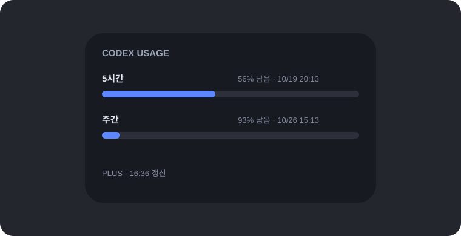

# UsageWidget


[](https://github.com/sloth197/UsageWidget/releases)

**English** · [한국어](README.ko.md)

## About

UsageWidget is a lightweight Windows desktop widget that keeps your Codex usage visible without interrupting your workflow.

It combines a compact always-on-top card with opacity control, free dragging, dynamic usage windows, and a Jelly Card interaction that makes the gauge bend with the surface.



### Tags

`windows` `wpf` `dotnet` `codex` `usage-monitor` `desktop-widget` `jelly-ui` `spring-animation` `always-on-top`

## Features

- Dynamically displays only the usage windows returned by the server
- Supports plan-specific windows, credits, and unlimited accounts
- Refreshes automatically every minute
- Reads the usage snapshot without sending an AI model request
- Adjustable opacity slider
- Always-on-top window with free dragging
- Jelly Card edge deformation that bends the usage gauge with the surface
- Multi-resolution `%` application icon

## Download

Download the latest Windows x64 build from [Releases](https://github.com/sloth197/UsageWidget/releases).

Current release: [UsageWidget v0.1.0](https://github.com/sloth197/UsageWidget/releases/tag/v0.1.0)

## Build

Requirements:

- Windows 10/11 x64
- .NET 10 SDK
- Codex desktop app installed and signed in (required to read usage)

```powershell
dotnet publish .\CodexUsageWidget\CodexUsageWidget.csproj `
  -c Release -r win-x64 --self-contained true `
  -p:PublishSingleFile=true `
  -p:IncludeNativeLibrariesForSelfExtract=true `
  -o .\publish
```

The executable is created at `publish\CodexUsageWidget.exe`.

## Privacy and limitations

This is an unofficial community project, not an official OpenAI product. It reads the current usage snapshot through the local app-server interface of the installed Codex desktop app. That internal interface may change when Codex updates.

The widget does not read or store passwords, API keys, conversation contents, or account credentials. If Codex is not installed or signed in, the widget shows a refresh failure instead of inventing usage values.

## License

MIT License. See [LICENSE](LICENSE).
